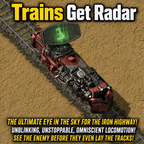

# WePlay: Trains Get Radar

Every locomotive charts the map around it like a radar, so your rail network lights up on the map as trains run.



No equipment, no hidden radar entities, no power draw. Moving trains chart constantly, parked trains refresh on a slower timer, and overlapping trains share the work so busy stations cost about the same as a single train.

## Features

- **Every locomotive is a radar.** The chunks around each locomotive are charted for its force as it travels.
- **Moving vs. parked.** Moving locomotives chart every scan interval; stopped locomotives refresh on a slower, separate timer (or not at all, if you prefer).
- **Shared work.** A chunk charted recently by one locomotive is skipped by the others, so multi-locomotive trains and crowded stations don't multiply the cost.
- **Lag-friendly.** Scans are spread evenly across ticks instead of all landing at once, so large networks don't cause spikes.
- **Works with modded locomotives.** Any entity of type `locomotive` is picked up, including ones placed by robots, cloned, or created by other mods' scripts.
- **Safe to add to an existing save.** On load the mod scans every surface for existing locomotives.

## Installation

Install from the in-game mod manager (search for **WePlay: Trains Get Radar**) or download it from the [Factorio mod portal](https://mods.factorio.com/mod/WePlayTrainsGetRadar).

Requires Factorio 2.1. Space Age is optional.

## Mod settings

All settings are map settings (runtime-global) and can be changed mid-game.

| Setting | Default | Range | What it does |
|---|---|---|---|
| Radar radius (chunks) | 2 | 0–8 | Chunks charted around each locomotive. 0 charts only the locomotive's own chunk; 2 charts a 5×5 chunk area, like a vanilla radar's nearby area. |
| Scan interval (ticks) | 120 | 10–3600 | How often each moving locomotive charts its area (60 ticks = 1 second). |
| Parked train refresh (seconds) | 30 | 0–3600 | How often a stopped locomotive refreshes its area. 0 means parked trains don't chart until they move again. |

Larger radii chart (2r + 1)² chunks per scan, so a radius of 8 is 289 chunks per locomotive. Raise the radius or lower the interval gradually on big networks.

## Compatibility

- **Space Age:** works on every planet; each locomotive charts the surface it's on.
- **Space Exploration and other overhauls:** modded locomotives are tracked automatically.
- **Other radar mods:** no conflicts expected; this mod only calls `force.chart` and adds no entities.

## Remote interface

Other mods, or the console, can force a full rescan or check how many locomotives are tracked:

```lua
/c remote.call("WePlayTrainsGetRadar", "rebuild")
/c game.print(remote.call("WePlayTrainsGetRadar", "count"))
```

`rebuild` is only needed if a mod creates locomotives without raising any build or train-created event.

## Known limits

- The map shows a snapshot from the last time a locomotive charted that area, not a continuous live view like the area right around a powered radar.
- A parked locomotive's refresh is checked once per scan interval, so the actual refresh time can be up to one interval longer than the setting.

Ideas or requests? Leave them in the Discussion tab on the [mod portal page](https://mods.factorio.com/mod/WePlayTrainsGetRadar/discussion).

## License

Released under the [Unlicense](LICENSE) — public domain. Do whatever you like with the code.
